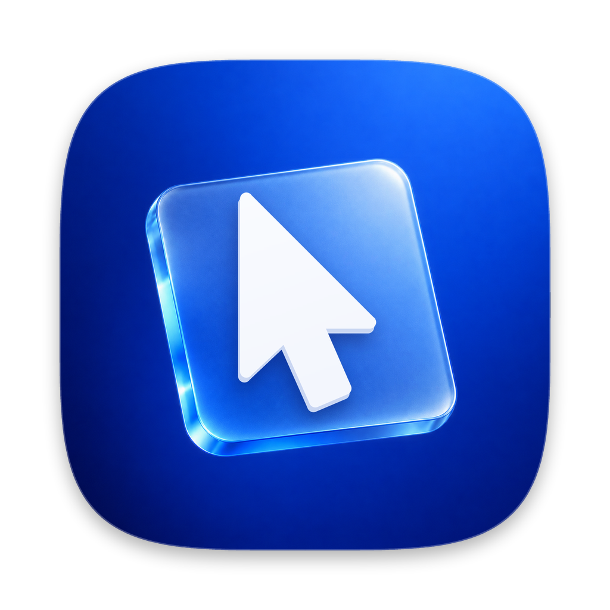
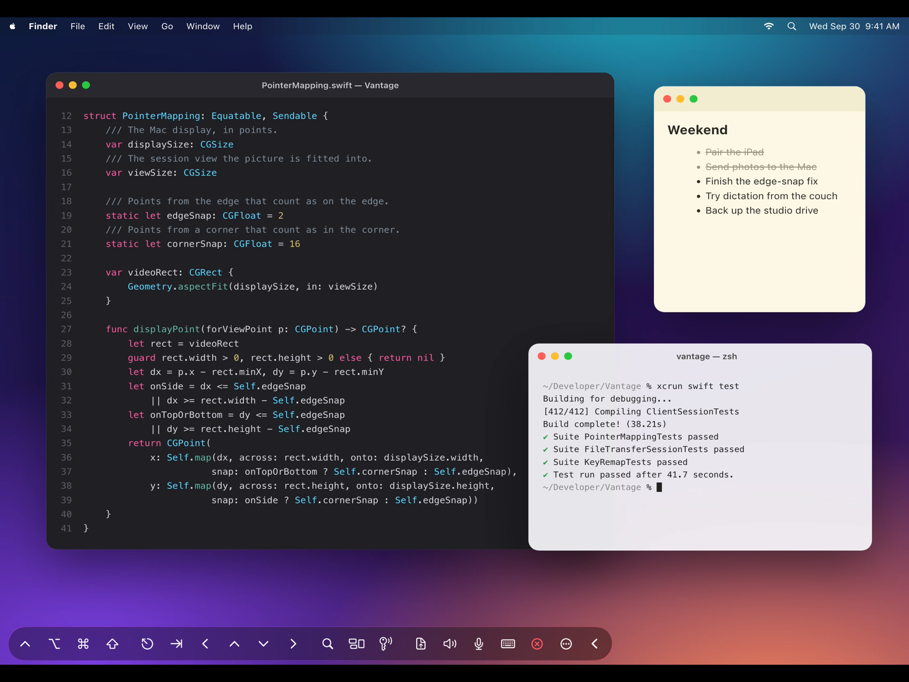
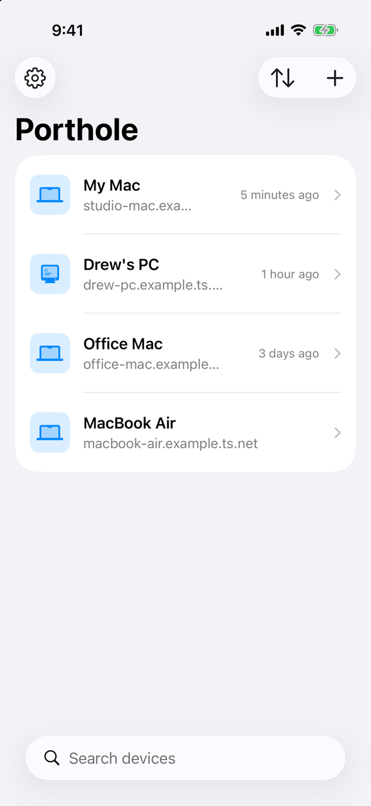
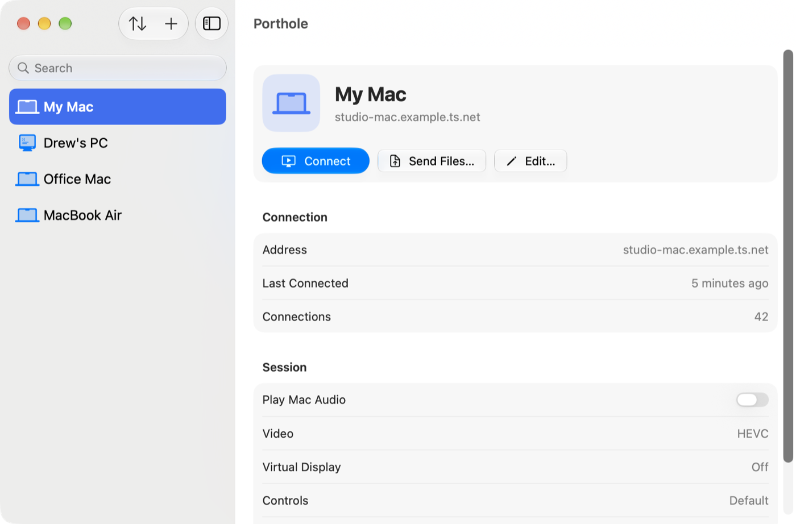
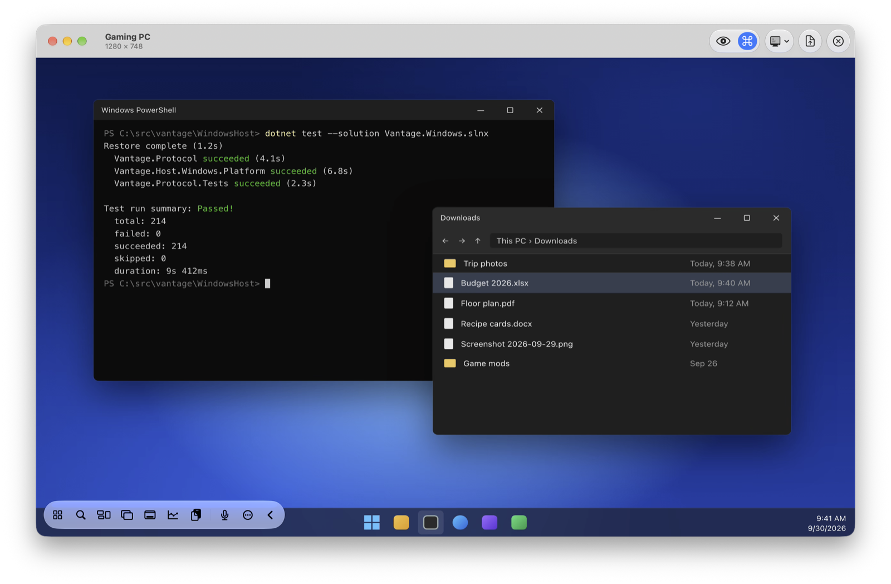

<p align="center">
  
</p>

<h1 align="center">Casement</h1>

<p align="center">
  <b>A free, private remote desktop for your Mac and PC.</b><br>
  Control them from an iPad, iPhone, Mac, or Apple Vision Pro, over your own Tailscale network.<br>
  No account, no relay server, no tracking.
</p>

<p align="center">
  <a href="LICENSE"></a>
  
  
  <a href="https://ko-fi.com/dlev384895"></a>
</p>

<p align="center">
  
</p>

<table>
  <tr>
    <td width="22%" valign="top"></td>
    <td width="39%" valign="top"></td>
    <td width="39%" valign="top"></td>
  </tr>
  <tr>
    <td align="center">iPhone</td>
    <td align="center">Mac</td>
    <td align="center">A Mac controlling a PC</td>
  </tr>
</table>

<sub>Screenshots show made-up desktops streamed from a test host.</sub>

## Getting Casement

Casement is free and open source. Version 1.0 is **in App Review** for iPhone, iPad, Mac, and Apple Vision Pro (one purchase-free app for all four, listed as "Casement: Remote Desktop"); the App Store link goes here as soon as it's live.

**Casement Host** is the small app that runs on the computer you want to control. Download it from [Releases](https://github.com/dlev02/Casement/releases/latest):

| Computer | Download | Install |
| --- | --- | --- |
| Mac (macOS 26 or later) | `Casement-Host-…-mac.dmg` | Open the DMG and drag Casement Host to Applications, then open it. A setup window walks you through Screen Recording, Accessibility, starting at login, and pairing. Signed and notarized by Apple. |
| Windows PC (Intel or AMD) | `Casement-Host-…-windows-x64.zip` | Unzip anywhere and run `VantageHost.exe` in the Casement Host folder. |
| Windows PC (ARM) | `Casement-Host-…-windows-arm64.zip` | The same; not yet tested on ARM hardware. |

The Windows app isn't code-signed yet, so Windows may say the publisher is unknown: choose **More info › Run anyway**. Allow it through Windows Firewall when asked. Each release lists SHA-256 checksums.

You can also [build everything from source](#building-from-source).

Casement will stay free, with no ads, subscriptions, or in-app purchases. Publishing does cost money: Apple's developer program is $99 a year, and signing the Windows host costs extra. If Casement is useful to you, [a coffee on Ko-fi](https://ko-fi.com/dlev384895) helps keep it on the store.

## What it does

**See your screen, sharp and fast.** Hardware HEVC or H.264 encoding with low-latency settings, colour-accurate from end to end. Bitrate and frame rate adapt to your connection; text stays crisp and motion stays smooth. Optionally, a Mac can make a virtual display shaped like your iPad (with [BetterDisplay](https://github.com/waydabber/BetterDisplay)).

**Control it naturally.**
- *iPad and iPhone:* Trackpad or Direct Touch, two- and three-finger clicks, scrolling with momentum, Apple Pencil, and a hardware keyboard, mouse, or trackpad. Move the pointer into a screen edge or corner and the Mac's Dock, menu bar, and hot corners respond.
- *Mac:* each computer opens in its own window. Your keyboard shortcuts go through, and full screen really is full screen.
- *Apple Vision Pro:* look and pinch, in windows that keep the computer's shape.
- A **control strip** you can customize per computer, with Mission Control, Spotlight, Show Desktop, and the modifier keys (or Start, Task View, and Task Manager on a PC). Drag it to any corner or collapse it.

**Move files both ways.** Drop files onto the screen, send them from another app, or send them from the device list without opening the screen at all. Big transfers resume where they stopped after a dropped connection and keep going after you disconnect.

**Hear your Mac.** Stream the Mac's sound to your device with low latency (Opus).

**Dictate.** Speak and Casement types for you, transcribed on your device or on the Mac with [MacWhisper](https://goodsnooze.gumroad.com/l/macwhisper) or a built-in Parakeet model.

**Share the clipboard.** Text, rich text, and images. What you copy on the computer arrives on your device; your device's clipboard is sent only when you ask.

**Get into a locked Mac.** Type your saved password even where macOS blocks typing (the lock screen, password fields), through the Mac's own Screen Sharing. Casement Host can also stop an accidental restart while you're connected, and **Restart Safely** gets past FileVault for a planned restart.

**Fit right in.** Siri and Shortcuts ("Connect to Studio in Casement"), Spotlight, Home Screen widgets, a Control Center control, a Face ID, Touch ID, or Optic ID app lock, and iCloud Keychain sync for saved passwords.

**Keep it private.** Everything travels directly between your devices inside Tailscale's encrypted tunnel. Each device has its own key and pairs once with a six-digit code. See the [privacy policy](PRIVACY.md).

## Platforms

| | Requirement | Notes |
| --- | --- | --- |
| **Casement** for iPad and iPhone | iPadOS or iOS 26 | Universal app with widgets and Siri |
| **Casement** for Mac | macOS 26 | Native, sandboxed, one window per computer |
| **Casement** for Apple Vision Pro | visionOS 26 | Native, one window per computer |
| **Casement Host** for Mac | macOS 26 | Menu-bar app. Needs Screen Recording and Accessibility |
| **Casement Host** for Windows | Windows 10 (2004) or Windows 11 | Tray app. Mac audio, Type Password, and the virtual display are Mac-only |

Both devices need [Tailscale](https://tailscale.com), signed in to the same tailnet. Casement Host listens on TCP port 47820, and only to Tailscale addresses. Casement has its own protocol: it doesn't connect to VNC, Microsoft Remote Desktop, or Apple's Screen Sharing (apart from typing passwords).

## First connection

1. **Install Tailscale** on the computer and on your iPad, iPhone, Mac, or Vision Pro, and sign in to the same tailnet on both.
2. **Start Casement Host** on the computer.
   - *Mac:* it lives in the menu bar. Choose **Allow Screen Recording** and **Allow Accessibility** in its menu, approve Casement Host in System Settings › Privacy & Security, and reopen it if macOS asks.
   - *Windows:* it lives in the notification area. Click its icon for a panel with your devices and **Show Pairing Code**. See [`WindowsHost/README.md`](WindowsHost/README.md) for details.
3. **Add the computer** in Casement with **+**.
   - **Add from Tailscale…** lists your tailnet's Macs and PCs, with a live check for Casement Host. It needs a read-only key from the Tailscale admin console: an API access token, or an OAuth client with the `devices:core:read` scope. The key stays in your Keychain.
   - **Add Manually…** takes the computer's Tailscale IP address or MagicDNS name.
4. **Pair.** Choose **Pair a Device** in Casement Host’s menu on a Mac (or **Show Pairing Code** in its panel on Windows) and type the six digits into Casement. A code lasts 10 minutes and works once. After that, the device connects straight away.

The in-app **Help & FAQ** (Settings › About) covers controls, files, dictation, locked Macs, and restarts in more detail.

## Troubleshooting

| Symptom | Check |
| --- | --- |
| Can't connect, or keeps reconnecting | Tailscale is connected on both devices, Casement Host is running, and your tailnet's access rules allow TCP port 47820. |
| The pairing code is rejected | Show a fresh code on the computer. Codes expire after 10 minutes and after 5 wrong tries. |
| Casement asks you to grant Screen Recording | Approve Casement Host in System Settings › Privacy & Security › Screen & System Audio Recording, reopen it, then choose Retry. |
| Video works but clicks and typing don't | Approve Accessibility for Casement Host. If only typing fails, the Mac is locked or a password field has focus: use Type Password. |
| "Waiting for the Mac's screen…" | The display is asleep or reconfiguring. Choose Wake, or wait: Casement keeps trying. |
| The computer restarted and is unreachable | Tailscale starts only after someone logs in. See "Restarts & Locked Macs" in the in-app FAQ for Restart Safely, subnet routers, and Log In with Screen Sharing. |
| Virtual display isn't created | It needs BetterDisplay and its command-line tool. Without them, Casement streams the main display. |

## Building from source

You need a Mac with **Xcode 27** (the regular release, not a beta) and, to run on a device, your own Apple development team.

1. Open `Vantage.xcodeproj` (the project keeps the app's original code name). For each target, choose your team under Signing & Capabilities, and change the bundle identifiers (`me.drewlevinson.casement…`) and the App Group (`group.me.drewlevinson.casement`, in `Vantage/Vantage.entitlements` and `VantageWidgets/VantageWidgets.entitlements`) to your own. If your team doesn't have iCloud or App Groups, remove those entitlements: widgets and iCloud sync of the device list are the only things that need them.
2. Run the **VantageHost** scheme (it builds Casement Host) on the Mac you want to control.
3. Run the **Vantage** scheme (it builds Casement) on your iPad, iPhone, Mac, or Vision Pro.

From the command line:

```sh
export DEVELOPER_DIR=/Applications/Xcode.app/Contents/Developer
xcodebuild build -project Vantage.xcodeproj -scheme VantageHost -destination 'platform=macOS' -derivedDataPath .deriveddata
xcodebuild build -project Vantage.xcodeproj -scheme Vantage -destination 'generic/platform=iOS Simulator' -derivedDataPath .deriveddata
xcodebuild build -project Vantage.xcodeproj -scheme Vantage -destination 'platform=macOS' -derivedDataPath .deriveddata
```

The Windows host is C# on .NET 10. It builds and tests on a Mac, while the tray app itself builds on Windows. See [`WindowsHost/README.md`](WindowsHost/README.md).

### Tests

```sh
scripts/check.sh    # both Swift test suites, the host, and the iOS and macOS clients
```

Or run the pieces: `xcrun swift test --package-path Packages/VantageCore` (protocol, identity, transport, file transfer), `xcrun swift test` (the real client session code against a loopback host), and `cd WindowsHost && dotnet test --solution Vantage.Windows.slnx`. Golden wire vectors keep the Swift and C# sides byte-compatible.

To try the whole video path without granting any permissions, start a synthetic host (debug builds only). It streams a test pattern and never touches your real screen, input, or clipboard:

```sh
open -n ".deriveddata/Build/Products/Debug/Casement Host.app" --args --synthetic-capture --port 47821 --pairing-code 246810
xcrun simctl launch booted me.drewlevinson.casement -VantageAutoConnect 127.0.0.1:47821 -VantagePairingCode 246810
```

Quit the synthetic host afterwards, and leave port 47820 to the real host.

## How it works

```text
Mac host:      ScreenCaptureKit ─→ VideoToolbox (HEVC/H.264) ─┐
Windows host:  Graphics Capture ─→ Media Foundation (H.264) ──┤
                                                              │  one framed TCP stream per session,
                                                              │  plus a second one for files,
                                                              ▼  inside Tailscale's WireGuard tunnel
Client:        AVSampleBufferDisplayLayer ←── VantageCore ←───┘
               touch, pointer, keyboard, clipboard, mic ──→ CGEvent / SendInput on the host
```

| Path | What's there |
| --- | --- |
| [`Vantage/`](Vantage) | The client for iPhone, iPad, Mac, and Vision Pro (SwiftUI, plus AppKit and UIKit for input) |
| [`VantageHost/`](VantageHost) | The Mac host: capture, encoding, input, audio, dictation, files, and the menu-bar app |
| [`Packages/VantageCore/`](Packages/VantageCore) | Shared Swift package: wire protocol, transport, identity, file transfer |
| [`WindowsHost/`](WindowsHost) | The Windows host in C#, with a synthetic host for testing from a Mac |
| [`VantageWidgets/`](VantageWidgets), [`Shared/`](Shared) | Widgets and the code they share with the app |
| [`docs/research/`](docs/research/README.md) | Engineering notes behind the harder decisions, with sources |
| [`CLAUDE.md`](CLAUDE.md) | The engineering guide: architecture, conventions, debug flags, and gotchas |

## Privacy and security

Casement collects nothing. There are no Casement servers, and the developer never sees your screen, files, or keys. Casement relies on Tailscale for encryption and adds per-device Ed25519 keys and pairing on top. Casement Host refuses anything outside Tailscale's address ranges. It hasn't had an independent security audit.

- [Privacy Policy](PRIVACY.md)
- [Terms of Use](TERMS.md)
- [Security policy and reporting](SECURITY.md)

## Limits

- The computer has to be on, awake enough to reach, and logged in. Tailscale can't wake a sleeping Mac, and nothing can get past FileVault's pre-boot screen remotely (Restart Safely avoids it for planned restarts).
- There's no curtain mode: someone at the computer sees what you're doing.
- Windows hosts don't stream sound, type saved passwords, or make virtual displays yet.
- Casement streams one display: the main display, or a virtual one sized to your iPad. There's no switching between several displays yet.

## Support Casement

Casement is a personal project, built to be the remote desktop I wanted. If it's useful to you, you can [buy me a coffee on Ko-fi](https://ko-fi.com/dlev384895). It helps cover the App Store and code-signing fees. Stars, bug reports, and ideas help too.

## Why "Casement"?

A casement is a window on hinges that swings open, the kind you push out to lean through. That's
the app: a window onto a computer that's somewhere else, which opens when you want it to and
only onto your own private network.

The project started life as **Vantage**, and was briefly called Porthole. Vantage still lives on
in the code (the Xcode project, targets, and the `VantageCore` package). Everything you see in the
apps says Casement.

## Contributing

Issues and pull requests are welcome. See [CONTRIBUTING.md](CONTRIBUTING.md).

## License

Casement is free software under the [GNU General Public License v3.0](LICENSE). Copyright © 2026 Drew Levinson.

It builds on [FluidAudio](https://github.com/FluidInference/FluidAudio) (Apache 2.0) and NVIDIA's Parakeet TDT 0.6B v3 model (CC BY 4.0) for optional on-Mac dictation, and, in the Windows host, [NSec](https://nsec.rocks) and [Vortice.Windows](https://github.com/amerkoleci/Vortice.Windows) (MIT). Casement isn't affiliated with Apple, Microsoft, or Tailscale.
