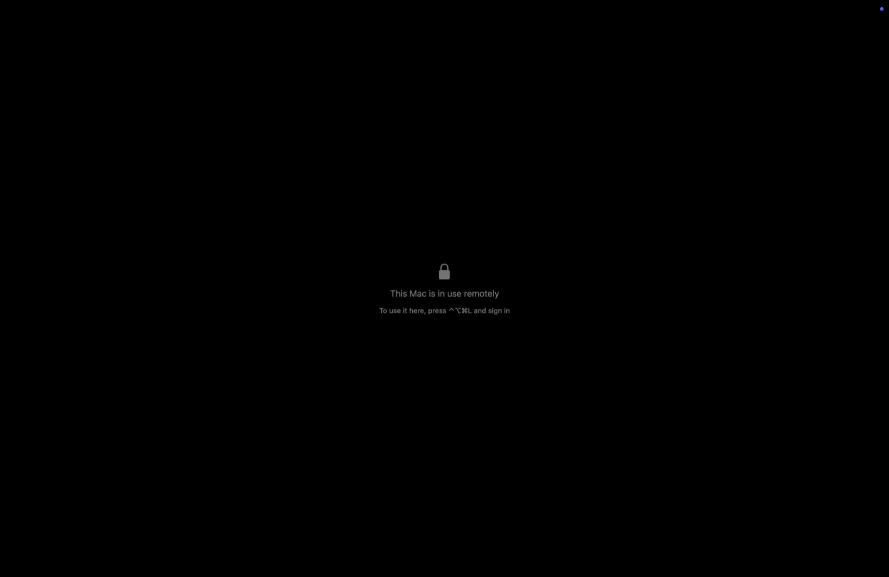
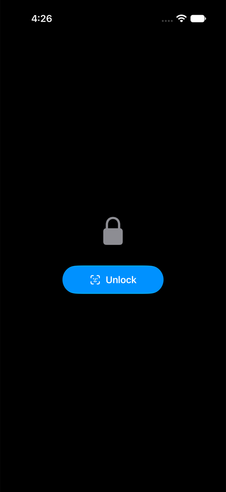
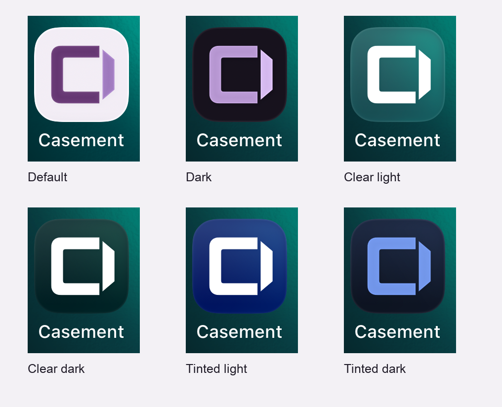
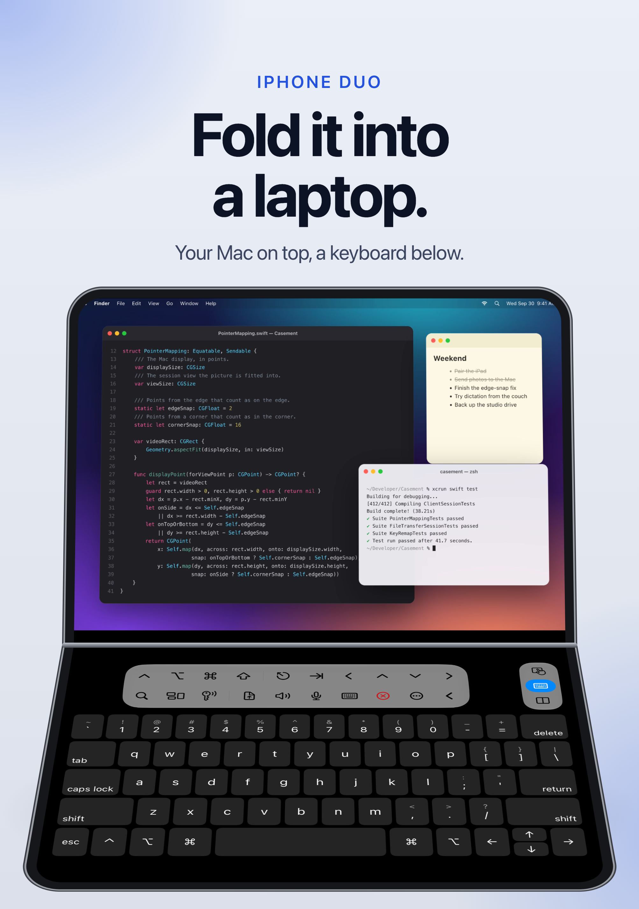

# Casement 1.1 — a window of your own

Builds 6 and 7 for iPhone, iPad, Mac, and Apple Vision Pro.

## Keep the screen to yourself

New in build 7. Leave a computer on at home and someone could open the lid and watch what you're
doing from across the world. **Curtain** blacks out the computer's own screen and ignores its
keyboard and mouse, while your picture stays the real desktop. Turn it on from the session menu or
Edit Device. It needs **Casement Host 1.6 or later**.

It only comes down onto something safe. A Mac locks a minute after your last device leaves, and
Control-Option-Command-L locks it sooner. A PC stays curtained for your next connection, because a
locked PC can't be unlocked from your device, until someone presses Windows-L at it.

## Unlock on your terms

Also new in build 7. Settings > Privacy & Security > Lock chooses how long Casement waits before
asking again: Immediately, 1, 5 or 15 minutes, or 1 hour. Swapping apps no longer means unlocking
every time. The lock screen is now a lock and one button.

## A window of your own

The new icon is a casement window shaped like a C, with one pane swung open. It follows light,
dark, clear, and tinted appearances on iPhone, iPad, and Mac; Apple Vision Pro has its own layered
circular artwork. The plum client mark belongs to the same family as the slate Host mark.

## Connect with confidence

Your Mac or PC now proves its identity before Casement signs in. Pairing instructions appear as
soon as you add a computer. Before typing a saved Mac password over a home-network connection,
Casement asks for confirmation. Use **Casement Host 1.4 or later**, available from
[Host downloads](https://github.com/dlev02/Casement/releases).

Your computer list also starts syncing through iCloud by default when available, so a new device
can pick up where the last one left off. Saved Mac passwords have a show-password button, and
files opened from another app ask for confirmation before they are sent.

## Control that fits

A half-folded iPhone Duo becomes a laptop: desktop above, keyboard below. The remote display
refits as the phone folds, unfolds, or rotates. Session controls take up less room on iPhone,
and the dictation meter follows your voice more clearly.

Windows pointer movement feels more immediate, with PC Audio and display-fitting options in the
client. New in build 7, with Casement Host 1.6, fitting a PC's display sets its scale as well as its
resolution, so the taskbar comes out a comfortable size on an iPad, as it does in Remote Desktop. Mac Settings resize to suit each tab. The iPad app running on a Mac opens its own Settings
and avoids asking for app unlock on every Space change.

## Testing this beta

Install over the existing TestFlight app and check that saved computers and pairings remain.
Connect to a Mac and a Windows PC, then try pointer input, keyboard shortcuts, clipboard, audio,
and file transfers both ways. Check the icon in each system appearance, and folding and rotation
on iPhone Duo. Use **Report a Problem** in Settings/About and attach diagnostics.

The complete tester instructions are in
[What to Test](../app-store/testflight-1.1-build-7.txt). Curtain and scale fitting need Casement Host
1.6, which this build does not publish, and this beta doesn't submit the client for public App Store
review.
