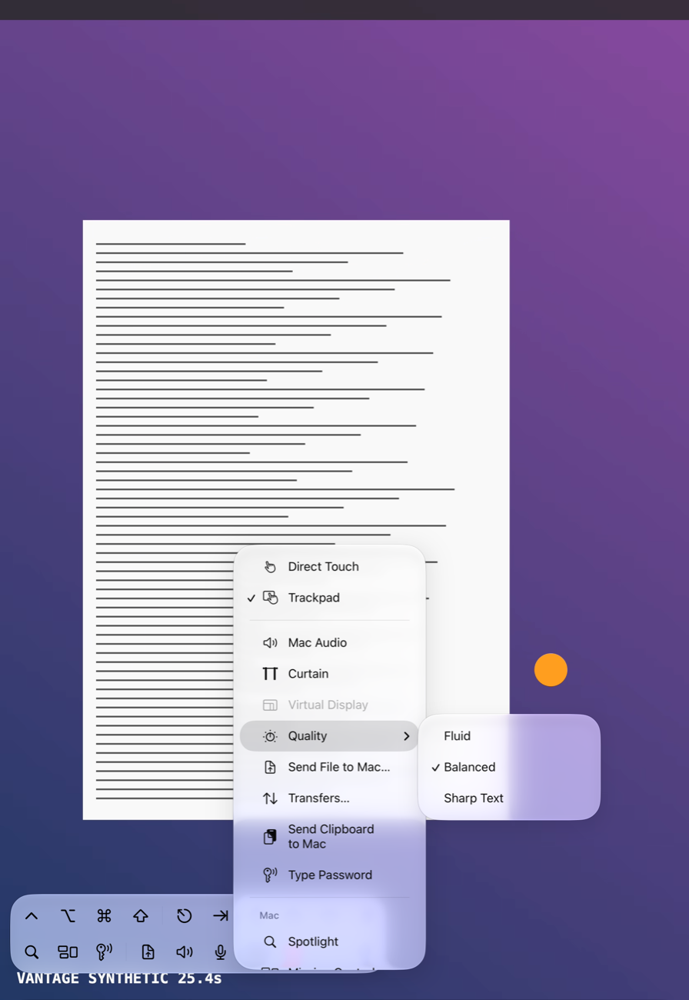
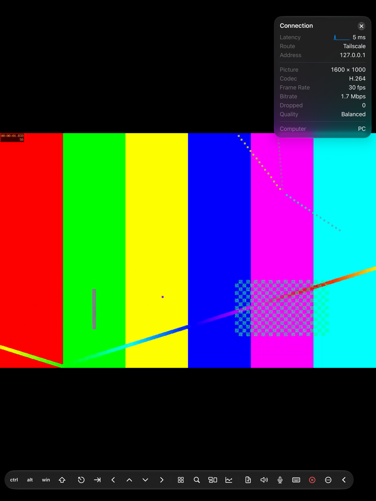
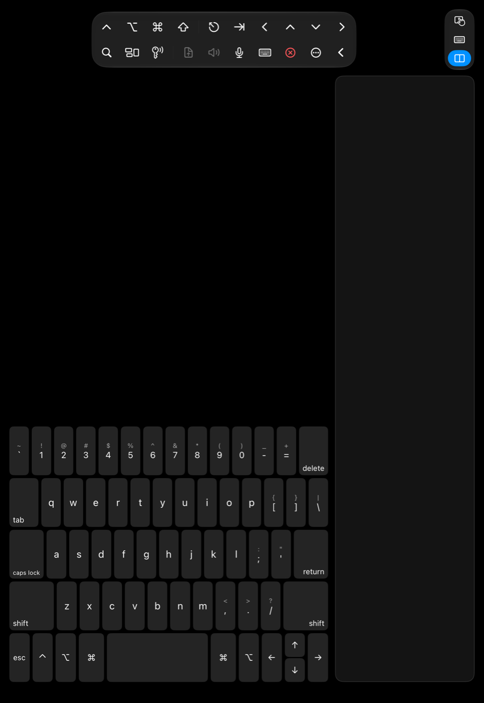
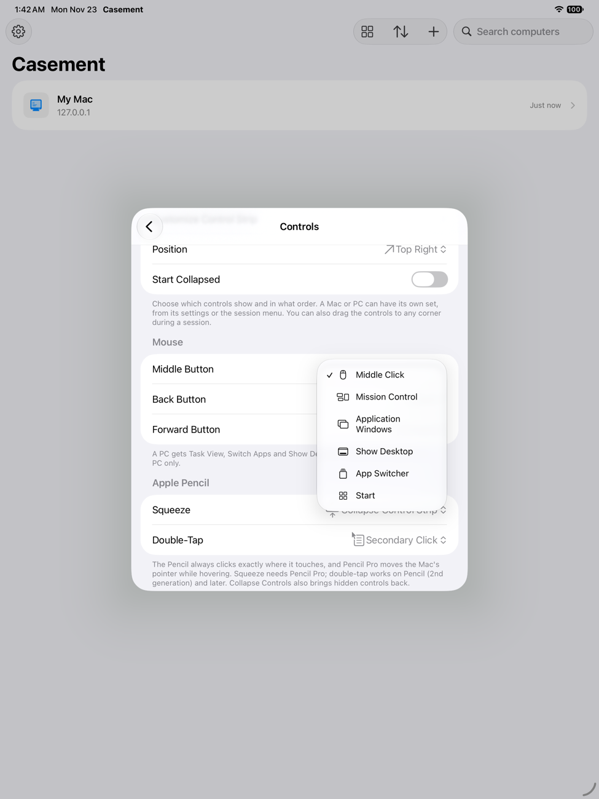
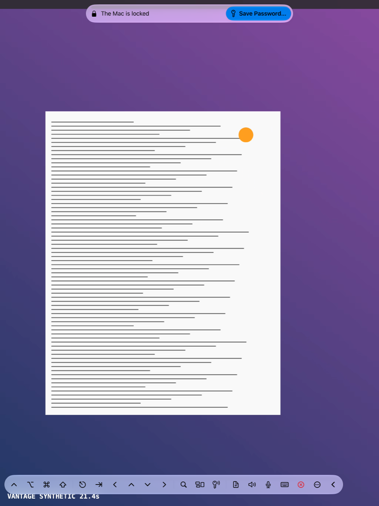
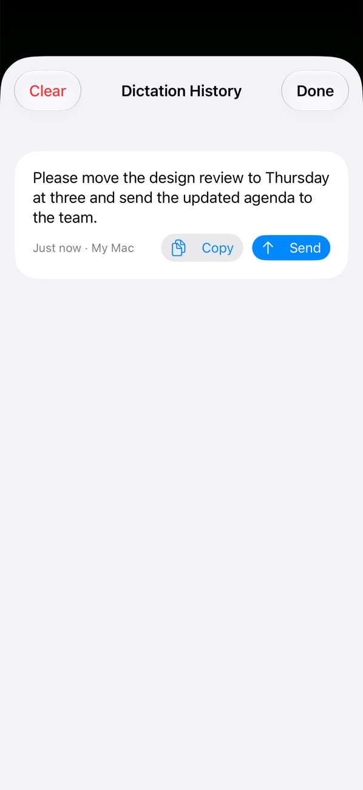

# Casement 1.2 — closer to the computer

Builds 8, 9 and 10 for iPhone, iPad, Mac, and Apple Vision Pro. Most of what's new in build 9 needs
**Casement Host 1.8** on the computer ([downloads](https://github.com/dlev02/Casement/releases/latest)).

## A picture that fits from the first frame

New in build 9. With Fit Display or Virtual Display on, Casement used to show the computer's old
shape for a moment and then jump. Now it holds the picture until the fitted one arrives, so the
session opens already the right shape.

**Quality** is a new choice in the session menu and Edit Computer:

- **Fluid** keeps motion at 60 frames a second.
- **Balanced** is what Casement did before, and still the default.
- **Sharp Text** spends more on detail, for reading and code.

Whichever you pick, text now sharpens a moment after the screen stops moving. Changing Quality
mid-session takes effect at once, without reconnecting.

## A PC that fills your screen

New in build 10. A PC used to open at its own shape and scale, which on an iPad meant a small
picture and a tiny taskbar. Casement now fits a PC's display to your device from the first
connection, at a size you can read and touch, and puts the PC back as it was when you leave. Fit
Display in the session menu or Edit Computer turns it off, and Casement remembers that. A Mac is
unchanged. The PC needs Casement Host 1.8 or later.

## How the connection is doing

New in build 10. **Connection** in the session menu (⌃⌥⌘I on the Mac) opens a small card in a
corner of the picture: latency, the route and address, the picture's size, codec, frame rate and
bitrate, dropped frames, and the Quality in use. The computer stays live underneath. Choose
Connection again, or the card's close button, to put it away.

## Your iPhone or iPad as a trackpad and keyboard

New in build 9. Touch and hold a Mac in the list and choose **Trackpad & Keyboard**. There's no
picture: your device becomes that Mac's trackpad and keyboard while you look at the Mac's own
screen. The Mac needs only Accessibility permission for it.

Also for hands:

- **Three-finger swipes** in Trackpad mode: left and right switch Spaces (or desktops on a PC), up
  opens Mission Control or Task View, down shows the app's windows or the desktop. Settings >
  Controls turns them off.
- **Apple Pencil pressure and tilt** reach drawing apps on a Mac.
- **Mouse buttons**, new in build 10: Settings > Controls > Mouse chooses what a mouse's middle,
  back and forward buttons do. Each can stay a click or open Mission Control, the app's windows,
  the desktop, the app switcher or Start (a PC gets Task View and its own versions). Buttons set up
  in a mouse maker's app on the computer don't carry over to a mouse paired with your iPad, so
  this is where to set them.
- **Scrolling a PC with a trackpad** goes the right way now, and each Mac's Natural Scrolling
  starts out matching that Mac's own setting.

## Unlock a Mac with Face ID

New in build 9. When a Mac is locked, the banner at the top has a button: save the Mac's password
once, and after that it's **Unlock** with Face ID or Touch ID. Saved Mac passwords now follow the
Mac itself rather than its address, and sync between your devices through iCloud Keychain, the Mac
app included.

Connecting to a Mac that was already locked used to say a secure text field was focused and offer
Approve. With the next Casement Host for Mac it says the Mac is locked and offers Unlock.

## Dictation you can pause and get back

New in build 9. Pause a dictation and carry on. **Dictation History** keeps what you dictated on
the device, to copy or send again; turn it off in Settings > Controls. The line that said where
transcription ran is gone. And Parakeet can now run on your own iPhone, iPad or Mac, so dictation
works with a computer that has no speech model (a one-time download from Hugging Face).

## Without Tailscale, at home

New in build 9, off by default on both ends. Turn on **Local Network** in Settings > Connection and
**Local network connections** in Casement Host for Mac, and a Mac you've already paired is found on
your own network or over a cable, even when its name or address changes. Casement encrypts these
connections itself, because Tailscale isn't there to. Pairing a new device still happens over
Tailscale, and a PC still connects over Tailscale only.

## On a PC

New in build 9. Casement tells you when Task Manager or another administrator app is in front and
your clicks can't reach it, and asks before opening Task Manager when they wouldn't. Casement Host
1.8 can go further, with an opt-in setting that lets you answer administrator prompts and unlock
the PC from your device.

## On the Mac

Build 8 made a PC fill a MacBook's display in Full Screen and made Fit Display a live switch.
Build 9 opens Settings as a sheet from the list, calms the buttons, and gives a new list a clearer
first screen.

Build 10 gives Full Screen a way out. With keyboard shortcuts going to the computer, the toolbar
never came back down, and only ⌃⌥⌘F left Full Screen. Now rest the pointer at the very top of the
screen for a moment and a small bar drops with Exit Full Screen and Disconnect. Moving along the
top to use the computer's own menu bar doesn't bring it up.

## Testing this beta

The complete tester instructions are in [What to Test](../app-store/testflight-1.2-build-9.txt).
These haven't been tried on real hardware yet, so they're where reports help most: three-finger
swipes, Apple Pencil in a drawing app, Local Network on a real network and over a cable, Trackpad
& Keyboard against a real Mac, and the Mac app's new Settings sheet. Use **Report a Problem** in
Settings/About and attach diagnostics.

In build 10, these haven't been tried on real hardware either: the bar at the top of Full Screen
on the Mac, a real mouse's middle, back and forward buttons (on iPad and iPhone the side buttons
may be swapped), a PC opening fitted, and Connection on an iPhone held upright.
