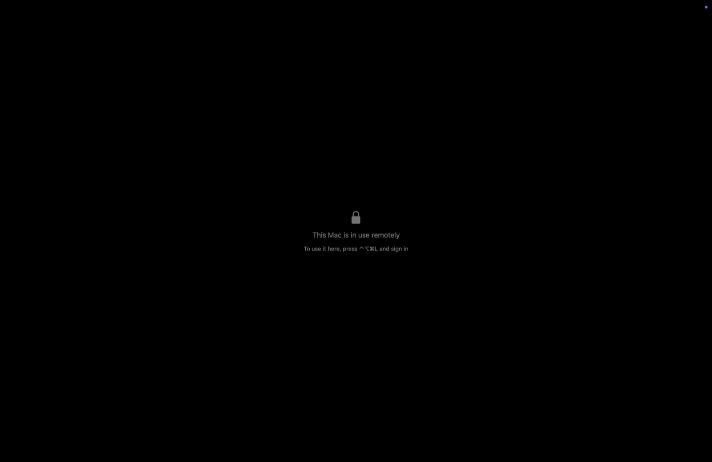

# Casement Host 1.6

## Keep the screen to yourself

Leave a computer on at home and anyone who opens the lid or turns on the monitor can watch what you're doing from across the world. **Curtain** blacks out the computer's own screen and ignores its keyboard and mouse, while your device still sees the real desktop and stays in control.

Turn it on in Casement 1.1 (build 7 or later), from the session menu or a computer's settings.

It only comes down onto something safe:

| | Mac | PC |
| --- | --- | --- |
| **You turn it off** | Lifts | Lifts |
| **Your last device leaves** | Locks after a minute, then lifts | Stays up for your next connection, because a locked PC can't be unlocked from your device |
| **Someone at the computer** | Control-Option-Command-L locks it and lifts the curtain | Windows-L locks it and lifts the curtain |
| **Casement Host stops unexpectedly** | The computer locks | The computer locks |

**Limits for now:** the computer's speakers still play, and on a Mac the pointer can still be seen moving over the curtain. On a PC, Start, Search and system prompts can appear above the curtain. Curtain's hands-on checks with a real keyboard and mouse are still under way, so please [tell me](https://github.com/dlev02/Casement/issues) if anything gets through.

## A PC that fits your screen

With **Fit the PC's display to this screen** on in Casement, the PC now changes its scale as well as its resolution. An 11-inch iPad gets a desktop about the size of its own screen, so the taskbar and everything else come out a comfortable size instead of tiny. Your resolution and scale come back when you disconnect, and windows on the PC may move while they change.

## Quicker Settings on the Mac

Switching tabs in Casement Host's Settings takes about half as long.

## Getting the update

Hosts running 1.4 or later update by themselves when nothing is connected, or you can check in **Settings → General → Updates**. Hosts older than 1.4 need a download by hand once.

- **Mac:** download the DMG, open it, and drag Casement Host to Applications. The app and DMG are signed, notarized, and stapled by Apple.
- **Windows, Intel/AMD:** download `Casement-Host-Setup-x64.exe` and choose Install.
- **Windows, ARM:** `Casement-Host-Setup-arm64.exe` is provided, but it probably won't start: a check of this package found x64 components, as in 1.5, and it has never been run on ARM hardware. I'm fixing that in a later release.

Saved pairings and settings stay in place. Windows packages are not code-signed, so Windows may warn about an unknown publisher; the update manifest is signed with the existing Casement update key. Checksums accompany the downloads.
