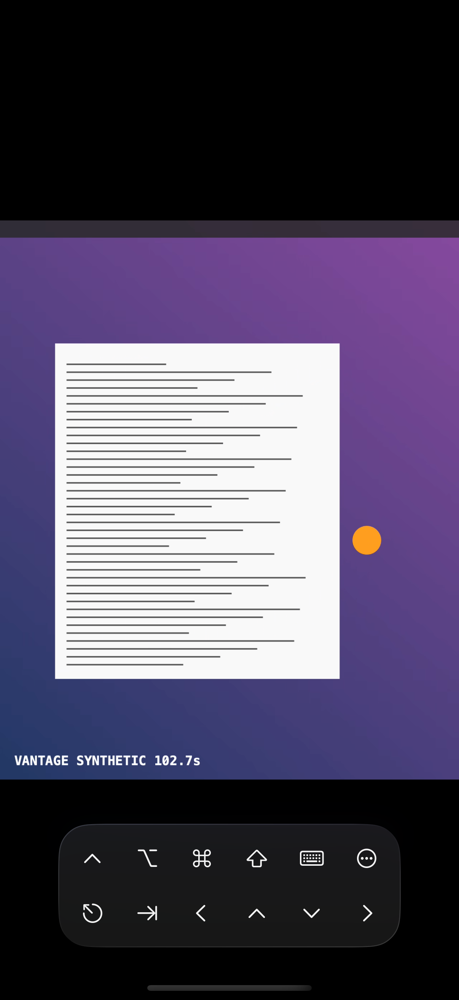
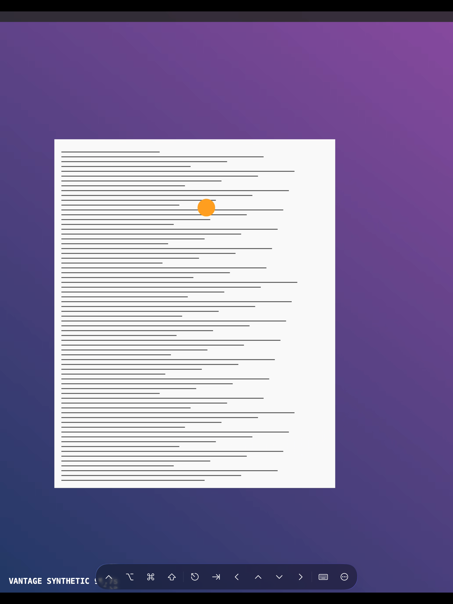
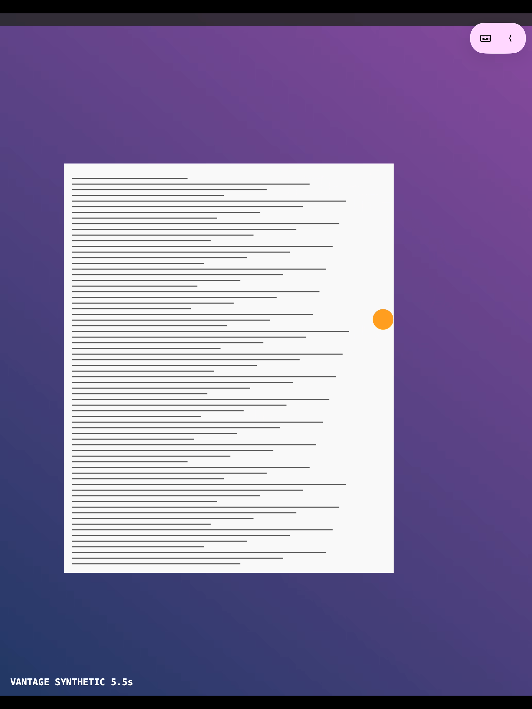
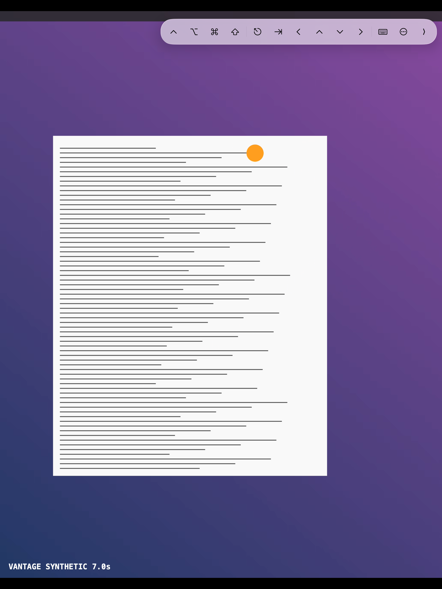

# Verification — 22 September 2026

This report records the initial development-preview check and subsequent physical-device follow-ups. It is not a comprehensive security audit. It follows the existing repository guidance and Axiom's SwiftUI adaptive-layout and build-debugging guidance.

## Environment and results

Final builds used **regular Xcode 27.0 (27A266a)** via `DEVELOPER_DIR=/Applications/Xcode.app/Contents/Developer`, reusing `.deriveddata`.

| Check | Result |
| --- | --- |
| Shared-core Swift tests | 13 passed |
| Client and renderer regression tests | 4 passed: pairing/bad-code retry, stream selection after reconnect, cancellation during handshake, plus four concurrent renderers producing 500 frames each |
| macOS host debug build | Passed |
| Universal iOS simulator debug build | Passed |
| Generic iOS device build, signing disabled | Passed; not installable until signed |
| Signed iOS build | Blocked: no development profile for `com.benjaminlevinson.vantage` |
| Physical iPad/iPhone installation | Not performed; Xcode reports the devices unavailable |
| Synthetic host → HEVC → loopback → iPad decoder/display | Passed; rendered moving test pattern captured |
| Host restart recovery | Passed; the still-running iPad client reauthenticated and negotiated a new 2064 × 2648 stream after restarting only the synthetic host |
| iPhone synthetic video | Passed; rendered stream in landscape and portrait |
| Narrow toolbar | All controls fit in two rows in iPhone portrait; one row in landscape and on iPad |
| Pairing prompt | Remained visible; Close dismissed it; authentication/retry behavior covered by automated tests |
| Session Options | Opened and rendered the native options popover after the fix |
| Toolbar modifier | Command changed from Off to On through a simulator tap |
| Whitespace and documentation links | Checked before committing |

After the renderer fix, the host remained running with both simulator clients connected for more than four minutes. This is a focused smoke check, not a long-duration reliability test.

### Rendered examples

Both captures show synthetic video, not the Mac desktop.

| iPhone portrait | iPad |
| --- | --- |
|  |  |

Build warnings remain in the existing host process-output helpers (`Readiness`, `TailscaleCLI`, `VirtualDisplayManager`) and the encoder's `CVPixelBuffer` sendable capture. App Intents metadata extraction is skipped because these apps do not depend on AppIntents. These warnings are not treated as proof of runtime safety; review their concurrency contracts before wider distribution.

## Changes prompted by the review

- Preserve first-time and bad-code pairing prompts instead of immediately replacing them with a generic failure.
- Request a stream on every authenticated connection, including reconnects; close replaced channels, bound handshake waiting, and cancel pending retries on dismissal.
- Remove the untracked polling task in the session view and update input geometry from negotiated stream state.
- Provide Close while connecting/reconnecting/pairing and record connection history only after authentication succeeds.
- Fit the toolbar to narrow windows, add readable accessibility labels and 44-point control areas, and use a working native options dialog.
- Send real Backspace/Return key events from software input, provide Done, and wait until the keyboard responder is attached before requesting focus.
- Honor saved scroll direction and trackpad sensitivity; use the current view's geometry instead of `UIScreen.main`.
- Keep device access unavailable while the optional app lock is active, and remain locked if system authentication is unavailable.
- Show an actionable Screen Recording denial and refresh the host's permission indicators while its menu is open.
- Restrict synthetic/fixed-code launch options to debug builds. Synthetic mode now has separate trust records and cannot inject real input, execute host commands, or exchange the real clipboard.
- Replace concurrent background AppKit string drawing in the synthetic renderer with per-frame Core Text drawing after a two-client run exposed an Objective-C exception.
- Use fictional preview devices and keep sample seeding debug-only.

## Remaining device checks

1. Connect Tailscale and finish sign-in on the physical iPad. Make the device available to Xcode and obtain the project's development signing profile, then install the updated client.
2. Approve Screen Recording and Accessibility for the normal Mac host. Relaunch it without synthetic arguments.
3. Pair through the visible code field and verify real display video, pointer movement, click/drag, scroll, modifier combinations, Backspace, Return, and software-keyboard show/dismiss behavior.
4. Verify clipboard text, RTF, and images in both directions using nonsensitive test data.
5. Test biometric/passcode success, cancellation, unavailable authentication, and locking with a session open.
6. Test physical trackpad/mouse handling, rotation and iPad multitasking, display wake, BetterDisplay provisioning, and start-at-login.

The simulator UI bridge could read controls and invoke some actions, but typing into the pairing field and selecting native popover actions did not produce a reliable observable result. These interactions are **not** claimed as passed. The six-digit pairing protocol and retry path were exercised over real loopback sockets, and the synthetic app run supplied its code through a debug launch argument. Native computer control also timed out. No macOS privacy grants, physical-device sign-in, reboot, or login-window unlock was performed.

## Scope limits

Windows hosting, file transfer, remote audio, login-window bridging, application icons, and signed distribution packaging remain unfinished. Host identity pinning, pairing-code expiry/rate limiting, and a broader concurrency/security review remain prerequisites for a broader release.

## Physical iPad follow-up

Later on September 22, regular Xcode produced a signed Release build of source commit `862a5ba` using the existing bundle ID and signing team. The provisioning profile covers the paired iPad; its signature, certificate membership, entitlements, and expiration were checked before installation. The profile expires September 29, 2026 at 12:49 p.m. America/Chicago; refresh before September 28 ends.

Authenticated CoreDevice commands over the temporary Tailscale relay returned success for installation, launch, and an installed-app query confirming Vantage 1.0 (1). The signed artifact and receipts are retained in the private sideload registry, and the temporary relay was closed. This supersedes the earlier signing and installation blockers in the table; real display, pairing, and input acceptance still require the checks above.

### Live connection and build 2 fixes

The first connection attempt saved an `address:port` string in the host field, preventing DNS/connection establishment. After separating the fields, host logs confirmed authenticated access from the physical iPad and real ScreenCaptureKit capture at 2420 × 1668. Drew confirmed live video, pointer movement/clicks, and software-keyboard typing into a normal text field all work. These basic checks supersede their pending status above; clipboard, editing keys/modifiers, lock behavior, and the other advanced checks remain outstanding.

The client now accepts pasted `host:port` entries both when saving and when connecting to an older saved entry. It validates ports instead of silently falling back. Incorrect pairing codes now display an explicit retry message. Six client/renderer tests pass, including address/IPv6 validation and an actual loopback pairing test that enters a wrong code, observes the error, and then succeeds with the right code. The client build number is 2.

## Build 3 — session controls, availability, and appearance

The toolbar now collapses to keyboard/expand controls and docks in any corner. Drag either state diagonally or along one axis; the dock and collapsed preference persist. Controls also expose named accessibility actions and position choices in Session Options. A native UI test caught plain-style SF Symbol buttons accepting touches only on the glyph: each label now has a rectangular 44-point hit target. Top docking leaves room for iPadOS window-management gestures; without that inset a downward drag could resize the app window instead.

Settings now has Appearance (Automatic, Light, Dark), Controls, Connection, and Privacy & Security pages. Keyboard behavior remains automatic: hardware keys send keystrokes, software text sends Unicode, and Return/Delete send key events. No unverified keyboard-mode switch was added.

Saved hosts are checked every 15 seconds while the device list is active, with a five-second timeout and at most four concurrent probes. A probe authenticates with the saved client identity, reads host permission readiness, and closes without requesting video or accessing clipboard/input. A reachable older host reports “Host online”; an updated host with both permissions reports “Available.” Other results distinguish pairing, permissions, incompatible versions, and unreachable hosts. This verifies the Vantage route, not Tailscale's account-wide device inventory.

Returning from the background immediately starts a fresh authenticated stream for the open session. Backgrounding closes the old channel and releases remote input. The selected device survives the optional lock overlay so unlocking can recreate the session. Biometric unlock itself still needs a physical check.

The host also now distinguishes a wrong pairing code from a missing code. Build 2 had client feedback but the host still returned the missing-code status; both sides now agree.

Validation with regular Xcode:

- Shared core: 14 tests passed, including optional-field compatibility with older peers.
- Actual client and renderer source: 11 tests passed, including foreground recovery, canceled handshakes, availability signatures/results/timeouts, and dock movement.
- Native UI tests: availability and Light/Dark settings, collapse/expand, dragging compact controls up/right and expanded controls down/left, and Home Screen/foreground recovery passed on iPad and iPhone simulators.
- Rendered Light/Dark settings and the compact/expanded iPad toolbar were inspected. Tests use synthetic video; these are not physical touch or keyboard acceptance.

The reproducible native UI command and isolated synthetic-host port are documented in the README.

| Compact controls at top right | Expanded controls at top right |
| --- | --- |
|  |  |

Both screenshots use the synthetic stream; no personal desktop content is retained.

### Build 3 delivery

The updated Mac host debug build and signed iOS Release build passed with regular Xcode. Source commit `b8fab0a` was installed in place on the physical iPad; authenticated CoreDevice install and installed-app queries confirmed Vantage 1.0 (3). The exact signed artifact and receipts are retained privately. The normal Mac host was restarted and verified listening on port 47820; the synthetic host and test clients were stopped.

Remote app launch was denied because the iPad was locked (`FBSOpenApplicationErrorDomain` 7). Opening build 3 and exercising the new controls on the physical iPad remain pending until the device is unlocked. Signing identity and device membership passed verification. The reused profile still expires September 29, 2026 at 12:49 p.m. Central; refresh by September 28. The update did not extend that expiry.

## Build 4 — connect time, controls, and settings

The 16-second connect was the host waiting on BetterDisplay's CLI (which returns "Failed." on this Mac) and then polling 15 s for a virtual display before falling back to the main display. Virtual display is now opt-in per device and the fallback path streams the main display at once; host logs show "stream setup took 489 ms" against the real display, with the first frame on the client within about a second of the TCP connect.

Click injection was verified against the real host over loopback: two simulator taps produced two mouse down/up pairs inside a throwaway target window on the Mac (`scripts/click-target.swift`). Consent dialogs (TCC "Allow") reject synthesized events by design and are not a Vantage bug.

The session controls now morph between a compact pill and the full strip inside one glass container with spring animations, and Session Options is a native menu (touch mode picker, clipboard, move/collapse submenu, destructive Disconnect). Settings: Appearance no longer shows the picker title as a row, Controls adds an On-Screen Keyboard mode (Unicode Text / Keystrokes), Connection shows Tailscale state and this device's tailnet address without the empty row, and About replaces the Version row. Device rows and cards use a tinted icon tile with a status dot and "Just now" for recent connections. 14 core tests, 13 client tests (two new for the key map), host and simulator builds pass. Client build number is 4; the physical iPad was not reachable from this Mac for installation.

## Build 5 — icon and current client delivery

The generated Vantage icons are included in the iOS/iPadOS client and macOS host. The client build number advanced to 5 so devices can distinguish this delivery from build 4. With regular Xcode, the shared core's 14 tests, the client package's 13 tests, and both native UI tests on each of the iPad and iPhone simulators passed. The macOS host Debug build and signed iOS Release build succeeded. The signed client passed strict signature verification, and its embedded profile covers both physical devices with the existing team and bundle identifier.

Authenticated CoreDevice installation, installed-app query, and launch succeeded on the physical iPad and iPhone. Both report Vantage 1.0 (5). The iPad was updated in place from build 4; this was the first iPhone install. The exact signed artifact and command receipts are retained in the private sideload registry. The reused profile expires September 29, 2026 at 12:49 p.m. Central, so the update did not extend the signing lifetime. Refresh by September 28. Physical build 5 video/input behavior and the new iPhone UI still await user acceptance; successful launch alone does not establish those flows.

## Build 6 — Tailscale device picker and iPad delivery

The new picker lists Macs from the Tailscale API, checks whether Vantage Host responds, and identifies unsupported platforms. The device-list delete action now asks for confirmation. The host can reuse a non-built-in display that already matches the requested viewport instead of provisioning another. Review against Tailscale's current documentation corrected the OAuth scope to `devices:core:read` and uses `connectedToControl` when `lastSeen` is absent; an unreachable probe no longer claims that the host is stopped.

Regular Xcode checks passed: 14 shared-core tests, 14 client tests, macOS host and iOS Simulator builds, and a native iPad picker test that displayed Macs and unsupported devices and added a Mac from a fictional fixture. The signed Release client passed strict signature verification, its entitlements matched the embedded profile, and the profile covered the paired iPad. Authenticated CoreDevice installation over build 5, installed-app query, and launch all succeeded for Vantage 1.0 (6). The exact artifact and receipts are retained privately, and the relay was closed. The Mac host was rebuilt, restarted while idle, and verified listening on port 47820. Live Tailscale API sign-in and physical picker behavior still need user acceptance. The reused profile expires September 29, 2026 at 12:49 p.m. Central; refresh by September 28.
